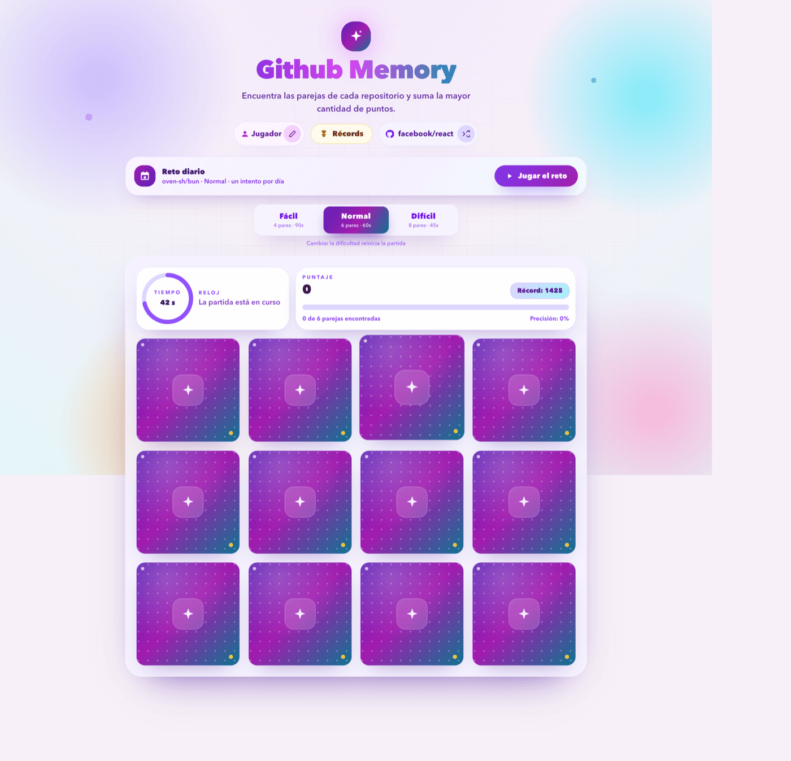
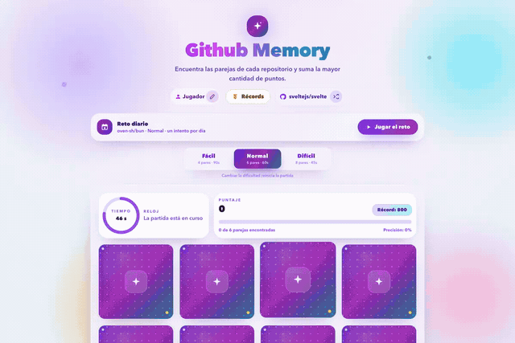

# Github Memory

A colorful, animated memory game that matches contributors from popular GitHub repositories. The current app is the second major evolution of the project, with refreshed visuals, new gameplay features, and a modernized frontend stack.

## Project versions

- **Version 2 (current):** the actively developed experience documented below.
- **Version 1:** preserved at the [`v1.0.0` tag](https://github.com/christianjtr/react-memory/tree/v1.0.0), a snapshot of the original game before the redesign and modernization.

The `v1.0.0` tag is an immutable historical reference; the default branch contains the evolved version 2 codebase. The `version` field in `package.json` is kept at `1.0.0` for that historical tag and is not used to label the current release.

## Live demo

https://christianjtr.github.io/react-memory

## Screenshots





## Tech stack

- React 19 + TypeScript 5.9
- Vite 8
- Tailwind CSS 4
- Motion 14 for interactive animations
- Vitest 5 + React Testing Library
- ESLint 10 (flat config) + Prettier 3

## Requirements

- Node.js 24.22.1 (pinned in `.nvmrc`; `package.json` requires >=24.15.0)
- npm 11.19.1 (pinned in `package.json`)

## Getting started

```shell
nvm use
npm ci
npm run dev
```

Each round starts with a randomly selected repository from a curated pool of popular
open-source projects. The active repository is shown above the board; use the shuffle
button or finish a round to choose another one. The previous repository is excluded
from the next selection. Contributor lists are cached in memory for the current page
session to reduce GitHub API requests.

To choose the initial repository, copy `.env.example` to `.env` and set both values:

```shell
VITE_REPO_OWNER=owner
VITE_REPO_NAME=repository
```

This only sets the initial repository; later rounds return to the random pool.

The GitHub API is public and rate-limited. No token or secret is required or stored
in the client. The app uses the first page of contributors returned by GitHub, which
provides more than enough candidates for the included difficulty levels.

## Gameplay and effects

- Choose **Easy** (4 pairs / 90 seconds), **Normal** (6 / 60), or **Hard** (8 / 45).
- Flip animated 3D cards, track your score, streak, accuracy and timer, and celebrate
  a win with confetti.
- Set your nickname to personalize the results screen.
- Close the result modal with the X button or Escape to inspect the finished board;
  the final score stays visible in the HUD, and a banner lets you reopen the results.
- Copy the repository link to share the game; round results remain visible in the
  results screen.
- Play the **daily challenge**: one seeded board per day for everyone, locked after
  your first attempt until the next UTC midnight.
- All progress is saved in browser `localStorage`; there is no backend.
- Animations respect the operating system's reduced-motion preference.

## Scoring

Each finished round is computed from four ingredients:

```
score = base + streak bonus + time bonus - error penalty

base          = pairs found × difficulty multiplier
multiplier    = easy 100 · normal 150 · hard 200
streak bonus  = (streak - 1) × 25 points per matching streak step (streak >= 2)
time bonus    = remaining seconds × 5
error penalty = mistakes × 25
```

- A mistake resets the current streak to zero (streak points already earned are kept).
- Accuracy is the rounded percentage of `pairs found / (pairs found + mistakes)`.
- Records are tracked per difficulty: best score, best time, best accuracy, games
  played, wins, and the best streak.

## Daily challenge

Every UTC day the app derives the same challenge for all players from the date:
a seeded repository pick from the curated pool and the normal difficulty. The board
layout is generated with a seeded shuffle, so everyone faces the same arrangement.

- One attempt per day: completing a round (win or lose) locks the challenge until
  the next UTC midnight. The panel shows your score and a live countdown.
- Daily attempts keep their own history and best score, separate from classic
  records.
- Known limitation: the deck layout is deterministic, but the underlying
  contributor list comes from the live GitHub API, so the exact people on the
  cards can vary between fetches.

## Storage keys

| Key                        | Contents                                        |
| -------------------------- | ----------------------------------------------- |
| `github-memory:v2:player`  | Nickname and player profile                     |
| `github-memory:v2:records` | Per-difficulty records and global best score    |
| `github-memory:v2:daily`   | Daily challenge history, best score and lock    |
| `github-memory:best-score` | Legacy v1 best score, migrated and then removed |

## Scripts

| Script                  | Description                        |
| ----------------------- | ---------------------------------- |
| `npm run dev`           | Start the development server       |
| `npm run build`         | Typecheck and build for production |
| `npm run preview`       | Preview the production build       |
| `npm run typecheck`     | Run TypeScript project references  |
| `npm run lint`          | Run ESLint                         |
| `npm run lint:fix`      | Fix ESLint issues                  |
| `npm run format`        | Format with Prettier               |
| `npm run format:check`  | Check formatting                   |
| `npm run test`          | Run tests                          |
| `npm run test:watch`    | Run tests in watch mode            |
| `npm run test:coverage` | Run tests with coverage thresholds |
| `npm run audit`         | Audit dependencies                 |
| `npm run check`         | Lint, typecheck, tests and build   |

## Architecture

```text
src/
  app/                       application bootstrap
  components/ui/             shared animated background and confetti
  features/
    contributors/            GitHub API, repository pool, adapter, hook and types
    game/                    animated UI, context, reducer, hooks, difficulty and deck logic
    player/                  nickname identity and settings modal
    records/                 per-difficulty records store and modal
    share/                   repository-link clipboard sharing
    daily/                   seeded daily challenge, store, hook and panel
  lib/                       shared utilities (storage, seeded random, shuffle, assertNever)
  styles/                    Tailwind entry point
  test/                      test setup, fixtures and renderWithGameState helper
  vite-env.d.ts              Vite client type declarations
```

The project is organized by feature. Game rules live in a pure reducer; API access,
validation and mapping are isolated from UI components.

## Quality and security

- `npm audit` reports zero vulnerabilities.
- Dependabot runs weekly: npm dependency updates are grouped in a single pull
  request per ecosystem group, while GitHub Actions updates are proposed
  individually.
- Repository segments are validated before building the GitHub API URL.
- Random repository choices come from a curated list of popular public projects.
- Contributor results are cached in memory for the current page session.
- API responses are validated and avatars are restricted to
  `https://avatars.githubusercontent.com`.
- CI runs audit, lint, typecheck, tests with coverage and a production build on every
  push and pull request to `develop`.
- The production build is deployed to GitHub Pages: the deploy workflow builds from
  `develop` and publishes the result to the `demo` branch. It only runs when build
  inputs change, so documentation-only pushes do not trigger a deployment.
