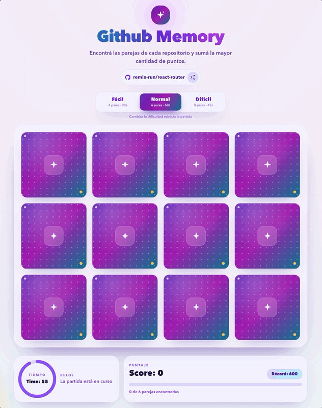

# Github Memory

A colorful, animated memory game that matches contributors from popular GitHub repositories. The current app is the second major evolution of the project, with refreshed visuals, new gameplay features, and a modernized frontend stack.

## Project versions

- **Version 2 (current):** the actively developed experience documented below.
- **Version 1:** preserved at the [`v1.0.0` tag](https://github.com/christianjtr/react-memory/tree/v1.0.0), a snapshot of the original game before the redesign and modernization.

The `v1.0.0` tag is an immutable historical reference; the default branch contains the evolved version 2 codebase.

## Live demo

https://christianjtr.github.io/react-memory

## Tech stack

- React 19 + TypeScript 5.9
- Vite 8
- Tailwind CSS 4
- Motion 14 for interactive animations
- Vitest 5 + React Testing Library
- ESLint 10 (flat config) + Prettier 3

## Requirements

- Node.js 24.15 or newer (see `.nvmrc`)
- npm 11

## Getting started

```shell
nvm use
npm ci
npm run dev
```

Each round starts with a randomly selected repository from a curated pool of popular
open-source projects. The active repository is shown above the board; use the shuffle
button or finish a round to choose another one. The previous repository is excluded
from the next selection. Contributor lists are cached in memory for the current page
session to reduce GitHub API requests.

To choose the initial repository, copy `.env.example` to `.env` and set both values:

```shell
VITE_REPO_OWNER=owner
VITE_REPO_NAME=repository
```

This only sets the initial repository; later rounds return to the random pool.

The GitHub API is public and rate-limited. No token or secret is required or stored
in the client. The app uses the first page of contributors returned by GitHub, which
provides more than enough candidates for the included difficulty levels.

## Gameplay and effects

- Choose **Easy** (4 pairs / 90 seconds), **Normal** (6 / 60), or **Hard** (8 / 45).
- Flip animated 3D cards, track your score and timer, and celebrate a win with confetti.
- Your best score is saved in browser `localStorage`.
- Animations respect the operating system's reduced-motion preference.

## Scripts

| Script                  | Description                        |
| ----------------------- | ---------------------------------- |
| `npm run dev`           | Start the development server       |
| `npm run build`         | Typecheck and build for production |
| `npm run preview`       | Preview the production build       |
| `npm run typecheck`     | Run TypeScript project references  |
| `npm run lint`          | Run ESLint                         |
| `npm run lint:fix`      | Fix ESLint issues                  |
| `npm run format`        | Format with Prettier               |
| `npm run format:check`  | Check formatting                   |
| `npm run test`          | Run tests                          |
| `npm run test:watch`    | Run tests in watch mode            |
| `npm run test:coverage` | Run tests with coverage thresholds |
| `npm run audit`         | Audit dependencies                 |
| `npm run check`         | Lint, typecheck, tests and build   |

## Architecture

```text
src/
  app/                       application bootstrap
  features/
    contributors/            GitHub API, repository pool, adapter, hook and types
    game/                    animated UI, context, reducer, hooks, difficulty and deck logic
  lib/                       shared utilities
  styles/                    Tailwind entry point
  test/                      test setup and fixtures
```

The project is organized by feature. Game rules live in a pure reducer; API access,
validation and mapping are isolated from UI components.

## Quality and security

- `npm audit` is expected to report zero vulnerabilities.
- Dependencies are grouped in weekly Dependabot pull requests.
- Repository segments are validated before building the GitHub API URL.
- Random repository choices come from a curated list of popular public projects.
- Contributor results are cached in memory for the current page session.
- API responses are validated and avatars are restricted to
  `https://avatars.githubusercontent.com`.
- CI runs audit, lint, typecheck, tests with coverage and a production build on every
  push and pull request to `develop`.
- The production build is deployed to GitHub Pages from `develop`.

## Demo


